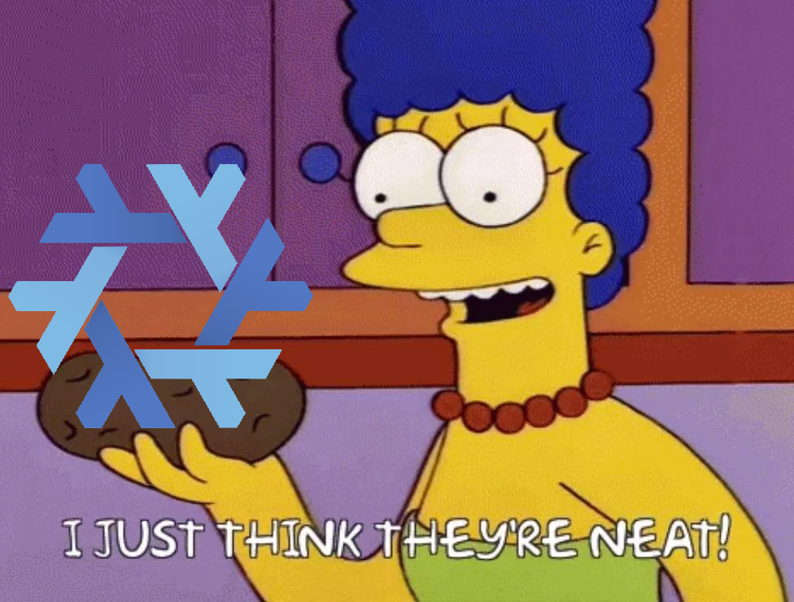

# An Introduction to Nix

---

# What is Nix?

- Package manager?
- Programming language??
- Build system????
- Linux Distribution????????

---

# Wait, what's a package manager?

> A package manager is software that supports installing, upgrading, configuring, and removing software for the host system in a consistent manner.

---

# What makes Nix differtent?

- Declarative
- Reproducible
- Reliable

---

# Declarative?

- Describe the outcome, not the action
- 

---

# Reproducible?

- Packages are built in isolation
- All dependencies are declared

---

# Reliable?

- Installing/uninstalling a package cannot break other packages
- Updated packages are not overwritten

---

# Ok, but what is actually useful for?

- Development environments
- User environment (home-manager)
- System configuration (NixOS)
- CI/CD

---

# Just use ~~Docker~~ Podman!

Nix:

- Bit-for-bit reproducability
- Atomic upgrades and rollbacks

Docker:

- Runtime isolation
- More established 

---

